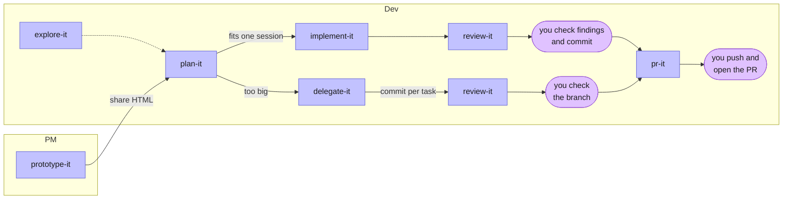

# skill-it plan

A team skill set for Claude Code, Codex, Cursor and Copilot, shipped as a Claude Code plugin. Skills are adapted from [mattpocock/skills](https://github.com/mattpocock/skills) (MIT) where one fits, and written fresh where none does.

## Decisions so far

| Topic | Decision |
|---|---|
| Name and hosting | `skill-it`, on personal GitHub. |
| Relation to Matt's repo | Fresh repo. Copy and rewrite chosen skills. No upstream sync. |
| Audience | Me plus a team (developers and product managers). |
| Harnesses | Claude Code, Codex, Cursor / Copilot / other Agent Skills harnesses. |
| Install | Claude Code plugin (`plugin.json` + `marketplace.json`). Codex and Copilot read the same manifests. |
| Naming | Commands use a `-it` suffix. |
| Invocation | Mixed: workflow commands run only when typed; helpers may be fired by the agent. |
| Output tone | Plain, concise prose. Skills set no "caveman" style; each user's own CLAUDE.md can add that. |
| Plan location (in consumer repos) | `docs/plans/<feature>/`, gitignored working files that are never committed. `plan-it` adds `docs/plans/` to `.gitignore` if missing. The lasting "why" lives in the PR body. |
| Task storage | One markdown file per task next to the plan, Matt's local ticket format. |
| PR body | Summary (visual), Why (1-3 lines, links the issue if there is one), Evidence (before/after), Merge Danger. Plus any extra sections the repo's PR template asks for. |
| Prototype | PM runs Claude Code in the repo; skill starts the app, captures the page from a browser, saves one self-contained HTML file, and publishes it as an artifact when in Claude. |
| Prototype to code | Prototype is an input to `plan-it`. No separate skill. |
| After implementing | Remove `[TEMP-…]` lines, then review in fresh-context subagents, then stop with changes uncommitted. In `delegate-it`, each implementer subagent removes its `[TEMP-…]` lines before committing its task. Neither skill changes code in response to review; findings and concerns go to the user. |
| Visualize | Mermaid flowchart, sequence, ER, state or timeline diagram. Flowchart nodes coloured by role from a fixed `classDef` palette (pastel fill, dark text); other types use the renderer's theme. Explaining: HTML page (pinned CDN) with a numbered step list for flowcharts and sequences, saved in `docs/plans/<slug>/visuals/` when tied to a plan, otherwise the OS temp folder; artifact when in Claude. Documenting: Mermaid block in `docs/<topic>.md` or the file the user names. Output is inferred from the request, never asked. |
| Glossary and ADRs | `plan-it` reads `GLOSSARY.md` and ADRs when a repo has them; never creates or edits them. |
| Review standards | Built-in baseline (scope, YAGNI, comment rules, Fowler smells) plus the repo's `CODING_STANDARDS.md` / `CONTRIBUTING.md`. A repo rule overrides the baseline. |
| TDD | Test-first where the repo has a test setup; if none, ask before adding one. |
| Delegate end state | Feature branch with one commit per task, reviewed by `review-it`, not pushed. |
| Prototype browser | Claude in Chrome or the Claude browser pane when present; otherwise Playwright MCP. |
| Prototype capture | `capture.js` runs in the page and POSTs the self-contained HTML to `receive.mjs`, a one-shot local Node receiver that writes the file. Changes are logged in a `PROTOTYPE CHANGES` comment that `plan-it` reads. |
| Temporary code | Every skill that adds a temporary line (debug log, manual-test hook) tags it with `[TEMP-<4 hex>]` and removes every tagged line by search before it finishes. |
| Cleanup | No separate skill. Tagged lines go in the skill that added them; untagged leftovers (debug output, commented-out code, new TODOs) are a `review-it` baseline finding. |
| Research location | `docs/plans/<feature>/research/<topic>.md` when tied to a plan; `docs/research/<topic>.md` otherwise. |

## Skills

| Skill | Source | Invocation | Job |
|---|---|---|---|
| `explore-it` | `codebase-design`'s "Design It Twice" | typed | When the solution is unknown: frame the problem, compare 2-4 radically different options with evidence, let the user choose, write `options.md` for `plan-it`. |
| `plan-it` | `grilling` + `to-spec` | typed | Interview in rounds until nothing is assumed, then write `plan.md`. Accepts a prototype as input. |
| `implement-it` | `implement` | typed | Build the plan, using `tdd` at agreed seams, remove its `[TEMP-…]` lines, then run `review-it` in subagents, and stop uncommitted. |
| `review-it` | `code-review` | auto | Review the branch diff on two axes (standards, plan) in parallel fresh-context subagents. |
| `pr-it` | `pr` | typed | Write the PR body. Does not open the PR. |
| `prototype-it` | `prototype` (heavily rewritten) | typed | Capture a running page into a self-contained HTML prototype a PM can iterate on and share. |
| `explain-it` | `wait-what` | auto | Re-explain the last message simply, with the missing context. |
| `visualize-it` | new | auto | Draw a process or system as a Mermaid diagram: an HTML page when explaining, a Markdown block in the repo when documenting. |
| `delegate-it` | `to-tickets` + `implement-spec` | typed | Split a large plan into tasks with blocking edges, then run implementer subagents across the ready tasks (each removes its `[TEMP-…]` lines before committing its task), then `review-it`. |
| `debug-it` | `diagnosing-bugs` | auto | Build a failing feedback loop first, then reproduce, hypothesise, instrument, fix, regression-test. |
| `handoff-it` | `handoff` | typed | Compact the session into a doc a fresh agent can continue from. |
| `research-it` | `research` | auto | Background agent reads primary sources and writes a cited markdown file. |
| `retro-it` | `retro` | typed | Suggest improvements to the agent environment after a session. |
| `tdd` | `tdd` | auto (reference) | Red-green loop and test-quality rules; loaded by `implement-it` and `delegate-it`. |
| `writing-for-agents` | `writing-for-agents` | auto (reference) | How to write skills and AGENTS.md; used when editing this repo. |

## Flow



Anytime: debug-it · explain-it · visualize-it · research-it · handoff-it · retro-it

## Repo layout

```
.claude-plugin/
  plugin.json          # lists every skill directory
  marketplace.json     # repo as its own marketplace
skills/
  <skill-name>/
    SKILL.md
    agents/openai.yaml # Codex display name; implicit-invocation policy for typed-only skills
    <REFERENCE>.md     # optional supporting files, owned by the skill
AGENTS.md              # conventions for editing this repo
CLAUDE.md              # points to AGENTS.md
README.md              # install + one line per skill
LICENSE                # MIT, keeping Matt Pocock's copyright notice for adapted skills
```

Flat `skills/` with no buckets: every skill ships, so there is no subset to curate.

## Consumer repo layout

```
docs/plans/<feature>/     # gitignored
  options.md
  plan.md
  tasks/NN-<slug>.md
  prototype/<name>.html
  research/<topic>.md
docs/research/<topic>.md   # research not tied to a plan
```

## Build order

1. Scaffold: git init, GitHub repo `skill-it`, manifests, LICENSE, AGENTS.md, README, `writing-for-agents`. Validate with `claude plugin validate . --strict`.
2. Core loop: `plan-it`, `tdd`, `implement-it`, `review-it`, `clean-it`, `pr-it`. Try on one real feature.
3. Helpers: `explain-it`, `debug-it`, `handoff-it`, `research-it`, `retro-it`, `visualize-it`.
4. `delegate-it`.
5. `prototype-it` (most novel; needs browser capture tested per harness).
6. Uninstall `mattpocock-skills` plugin to avoid duplicate skills.
