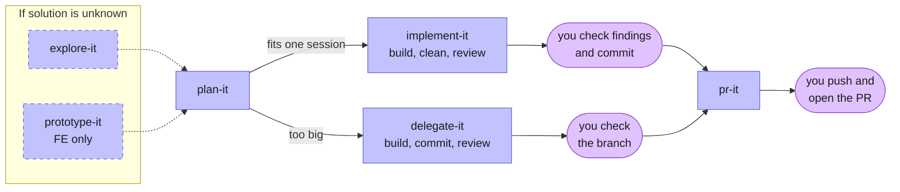

# skill-it

**Real agentic engineering, not vibe coding.**

Agent skills for planning and building for real engineers. Works in Claude Code, Codex, Copilot and other Agent Skills harnesses.

## Install

<details>
<summary><b>Claude Code</b></summary>

```bash
claude plugin marketplace add Myddis/skill-it
claude plugin install skill-it@skill-it
```

To update, run these and restart Claude Code:

```bash
claude plugin marketplace update skill-it
claude plugin update skill-it@skill-it
```

</details>

<details>
<summary><b>Codex</b></summary>

```bash
codex plugin marketplace add Myddis/skill-it
codex plugin add skill-it@skill-it
```

Codex refreshes the marketplace on startup. To update by hand, run this and restart Codex:

```bash
codex plugin marketplace upgrade skill-it
```

</details>

<details>
<summary><b>GitHub Copilot CLI</b></summary>

```bash
copilot plugin marketplace add Myddis/skill-it
copilot plugin install skill-it@skill-it
```

To update:

```bash
copilot plugin update skill-it
```

</details>

<details>
<summary><b>Cursor and other agents</b> (copies files)</summary>

```bash
npx skills@latest add Myddis/skill-it
```

To update:

```bash
npx skills@latest update
```

</details>

## Skills

**Typed** skills run only when you type `/skill-it:<name>` (Claude Code) or `/<name>` (installed via `npx skills`). **Auto** skills also start on their own when the agent sees the task fits.

The usual path through a feature:



Blue boxes are skills; purple ones are your steps. Most features start at `plan-it`: the dashed skills are only for when you don't yet know the solution.

Click a skill to see its full guide.

### Build a feature

<details>
<summary><b><a href="./skills/explore-it/SKILL.md">explore-it</a></b>: Compares possible solutions to a problem and helps you pick the best one.</summary>

- **What it does:** Frames the problem (goals, constraints, non-goals), then lays out 2-4 radically different solutions. Backs each with evidence from the code, research, small throwaway experiments, or diagrams. Compares them in one table (effort, risk, how reversible) with a clear recommendation, and lets you choose.
- **When to use it:** You know the problem but not the solution. Use `plan-it` directly when you already know what to build.
- **How to start it:** Typed: `/skill-it:explore-it`.
- **What you get:** `docs/plans/<feature>/options.md` with the options, the comparison, the decision and why. Gitignored like plans.
- **Works with:** `research-it` and `visualize-it` (evidence), `plan-it` (next step: pass it the options file).

</details>

<details>
<summary><b><a href="./skills/plan-it/SKILL.md">plan-it</a></b>: Interviews you until nothing about the work is assumed, then writes a plan.</summary>

- **What it does:** Asks questions in rounds, each with a recommended answer, until every decision is settled. Looks up facts in the code itself instead of asking you. Writes the agreed plan to a file.
- **When to use it:** Every time you are about to build something, before any code is written.
- **How to start it:** Typed: `/skill-it:plan-it`. You can pass a prototype file as input.
- **What you get:** `docs/plans/<feature>/plan.md`. The folder is gitignored, so plans are working files and never committed.
- **Works with:** `explore-it` and `prototype-it` (input), `implement-it` or `delegate-it` (next step).

</details>

<details>
<summary><b><a href="./skills/implement-it/SKILL.md">implement-it</a></b>: Builds the plan, has it reviewed and cleaned, and leaves the changes for you to commit.</summary>

- **What it does:** Implements the plan, test-first where the repo has tests. Then removes the temporary lines it tagged, runs `review-it` in fresh subagents, and stops. It changes nothing in response to the review: findings and its own concerns go to you.
- **When to use it:** The plan fits in one agent session.
- **How to start it:** Typed: `/skill-it:implement-it`, pointing at the plan.
- **What you get:** Uncommitted changes, plus the review findings, its concerns, and what was cleaned up.
- **Works with:** `plan-it` (input), `tdd`, `review-it`, then `pr-it` after you commit.

</details>

<details>
<summary><b><a href="./skills/delegate-it/SKILL.md">delegate-it</a></b>: Splits a large plan into tasks and builds them in parallel with subagents.</summary>

- **What it does:** Breaks the plan into small end-to-end tasks, each noting which tasks must finish first. Runs a subagent per ready task, each in its own git worktree. Each subagent cleans its work and commits it. Merges everything into one feature branch and reviews the result. Like `implement-it`, it changes nothing in response to the review: findings and concerns go to you.
- **When to use it:** The plan is too big for one agent session.
- **How to start it:** Typed: `/skill-it:delegate-it`, pointing at the plan.
- **What you get:** Task files in `docs/plans/<feature>/tasks/`, and a feature branch with one commit per task. Nothing is pushed. A report lists anything left for you to check.
- **Works with:** `plan-it` (input), `tdd`, `review-it`, `pr-it`.

</details>

<details>
<summary><b><a href="./skills/review-it/SKILL.md">review-it</a></b>: Reviews a diff against the coding rules and against the plan.</summary>

- **What it does:** Two subagents with fresh context review the diff in parallel. One checks coding rules, including leftover debug code: a built-in baseline plus the repo's own `CODING_STANDARDS.md` or `CONTRIBUTING.md`. The other checks the diff against the plan: anything missing, wrong, or not asked for.
- **When to use it:** Before committing or opening a PR, or whenever you want a second opinion on a branch.
- **How to start it:** Auto, or typed: `/skill-it:review-it`. `implement-it` and `delegate-it` run it for you.
- **What you get:** Two lists of findings, one for rules and one for the plan.
- **Works with:** `implement-it`, `delegate-it`.

</details>

<details>
<summary><b><a href="./skills/pr-it/SKILL.md">pr-it</a></b>: Writes the pull request description.</summary>

- **What it does:** Writes a PR body with four sections: Summary (a small diagram or diff sketch), Why, Evidence (before and after), and Merge Danger (how reversible the change is and what it could affect). Adds any sections the repo's PR template asks for. It does not open the PR.
- **When to use it:** After you have committed, before opening the PR.
- **How to start it:** Typed: `/skill-it:pr-it`.
- **What you get:** A PR description ready to paste.
- **Works with:** `implement-it`, `delegate-it`.

</details>

<details>
<summary><b><a href="./skills/prototype-it/SKILL.md">prototype-it</a></b>: Turns a page of the running app into a clickable HTML prototype you can change and share.</summary>

- **What it does:** Starts the app, opens the page in a browser, and captures it into one self-contained HTML file that looks exactly like the real page. You then ask for changes to the prototype instead of the code.
- **When to use it:** A product manager (or anyone) wants to try out a change to the UI before a developer builds it.
- **How to start it:** Typed: `/skill-it:prototype-it`, run inside the repo. Needs the app running locally, Node.js, and a browser tool (Claude in Chrome, the Claude desktop browser, or the Playwright MCP server).
- **What you get:** An HTML file that opens with a double-click, plus a shareable artifact link when run in Claude.
- **Works with:** `plan-it`, which takes the prototype as input.

</details>

### Anytime helpers

<details>
<summary><b><a href="./skills/debug-it/SKILL.md">debug-it</a></b>: Finds the cause of a bug by first building a check that reliably fails.</summary>

- **What it does:** Builds a fast, repeatable command that fails on the bug, before reading code for theories. Then shrinks the case, ranks hypotheses, tests them one at a time, fixes the bug, and adds a regression test.
- **When to use it:** Something is broken, throwing, failing or slow, and the cause is not obvious.
- **How to start it:** Auto, or typed: `/skill-it:debug-it`.
- **What you get:** A fix, a regression test where one fits, and the confirmed cause.
- **Works with:** `review-it`, to check the fix before you commit.

</details>

<details>
<summary><b><a href="./skills/explain-it/SKILL.md">explain-it</a></b>: Re-explains the last message in simpler words.</summary>

- **What it does:** Restates the agent's last message with the missing context, in plain language and the project's own terms.
- **When to use it:** A reply did not make sense to you.
- **How to start it:** Auto, or typed: `/skill-it:explain-it`.
- **What you get:** A simpler explanation in chat.
- **Works with:** `visualize-it`, when a picture would explain it better.

</details>

<details>
<summary><b><a href="./skills/visualize-it/SKILL.md">visualize-it</a></b>: Draws a process or system as a Mermaid diagram.</summary>

- **What it does:** Turns a process, architecture, sequence of calls, schema, lifecycle or roadmap into a Mermaid diagram (flowchart, sequence, ER, state or timeline), with flowchart nodes coloured by role. For a repo or service, it builds the diagram from the real code and config and lists anything it could not verify.
- **When to use it:** A process has enough steps that text is hard to follow, or a flow should be documented next to the code.
- **How to start it:** Auto, or typed: `/skill-it:visualize-it`.
- **What you get:** When explaining, an HTML page in `docs/plans/<feature>/visuals/` when tied to a plan, otherwise in your OS temp folder, plus an artifact link when run in Claude; the diagram loads from a CDN, so viewing it needs internet. When asked to document or keep it in the repo, a Mermaid block in `docs/<topic>.md` (or the file you name) that GitHub renders.
- **Works with:** `explain-it`, `explore-it`.

</details>

<details>
<summary><b><a href="./skills/research-it/SKILL.md">research-it</a></b>: Researches a question in official sources and writes up the findings.</summary>

- **What it does:** A background agent reads primary sources (official docs, source code, specs) and writes the findings to a markdown file, citing each claim.
- **When to use it:** You need facts about a library, API or tool before deciding something.
- **How to start it:** Auto, or typed: `/skill-it:research-it`.
- **What you get:** `docs/plans/<feature>/research/<topic>.md` when tied to a plan, otherwise `docs/research/<topic>.md`.
- **Works with:** `plan-it`.

</details>

<details>
<summary><b><a href="./skills/handoff-it/SKILL.md">handoff-it</a></b>: Packs the current session into a document a fresh agent can continue from.</summary>

- **What it does:** Summarises the session: what was done, what is left, and which skills the next agent should use. Points to existing files instead of copying them.
- **When to use it:** The session is getting long, or someone else will continue the work.
- **How to start it:** Typed: `/skill-it:handoff-it`.
- **What you get:** A handoff document in your OS temp folder.
- **Works with:** Any skill.

</details>

<details>
<summary><b><a href="./skills/retro-it/SKILL.md">retro-it</a></b>: Suggests how to improve the agent's setup after a session.</summary>

- **What it does:** Reviews a session and suggests improvements to the agent's environment: missing lint rules or tests, unclear instructions, slow tool calls, missing access to information.
- **When to use it:** After a session where the agent struggled or made avoidable mistakes.
- **How to start it:** Typed: `/skill-it:retro-it`.
- **What you get:** A list of suggestions, most severe first.
- **Works with:** `writing-for-agents`.

</details>

### Reference skills

Other skills load these. You rarely need to start them yourself.

<details>
<summary><b><a href="./skills/tdd/SKILL.md">tdd</a></b>: Rules for test-first development and for writing tests worth keeping.</summary>

- **What it does:** Guides the red-green loop: one failing test, then just enough code to pass it, one slice at a time. Defines what a good test is and which patterns to avoid.
- **When to use it:** Building or fixing code in a repo with a test setup.
- **How to start it:** Auto, or typed: `/skill-it:tdd`. `implement-it` and `delegate-it` load it.
- **What you get:** Tests at agreed boundaries that check behaviour, not internals.
- **Works with:** `implement-it`, `delegate-it`.

</details>

<details>
<summary><b><a href="./skills/writing-for-agents/SKILL.md">writing-for-agents</a></b>: How to write skills, AGENTS.md and CLAUDE.md so agents follow them reliably.</summary>

- **What it does:** A reference for writing documents agents read: how to word skill descriptions so they trigger, what to keep in the main file versus separate files, and how to cut lines that change nothing.
- **When to use it:** Creating or editing a skill, `AGENTS.md` or `CLAUDE.md`.
- **How to start it:** Auto, or typed: `/skill-it:writing-for-agents`.
- **What you get:** Guidance applied while the agent writes; no file of its own.
- **Works with:** `retro-it`, and every skill in this repo while it is being written.

</details>

## License

MIT. Some skills are adapted from [mattpocock/skills](https://github.com/mattpocock/skills); see [LICENSE](./LICENSE).
